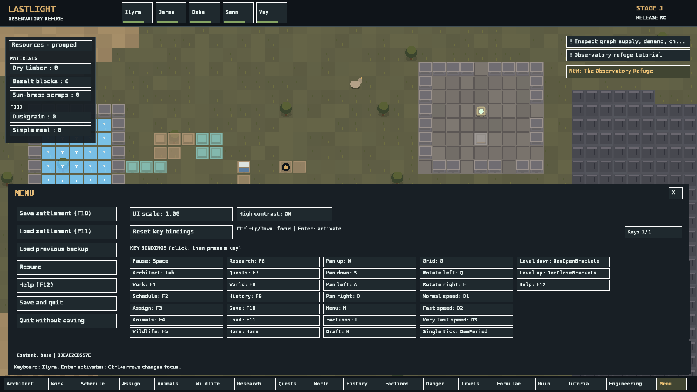
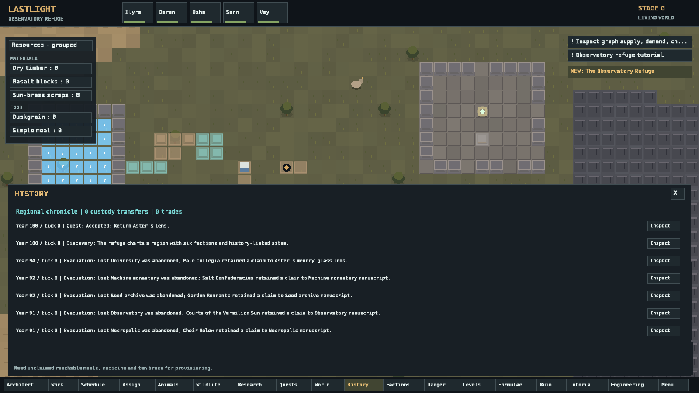
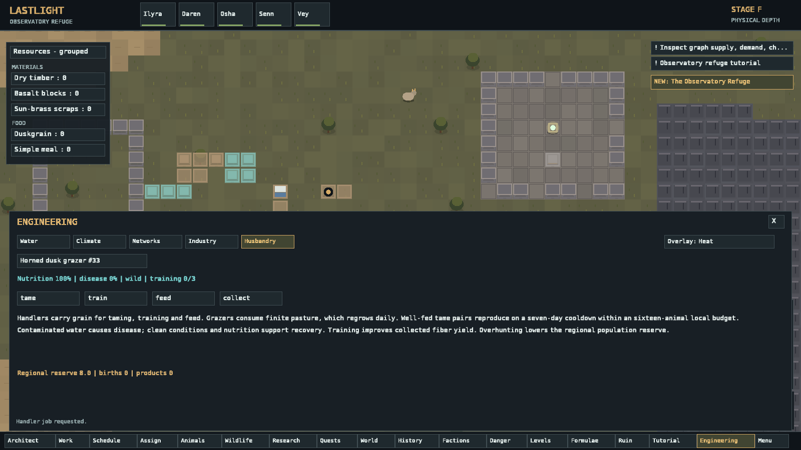
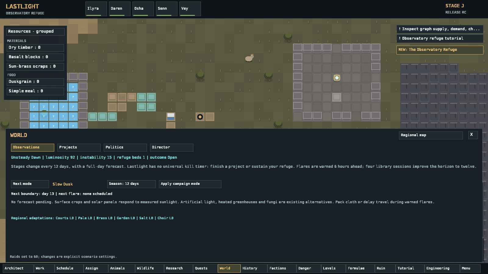
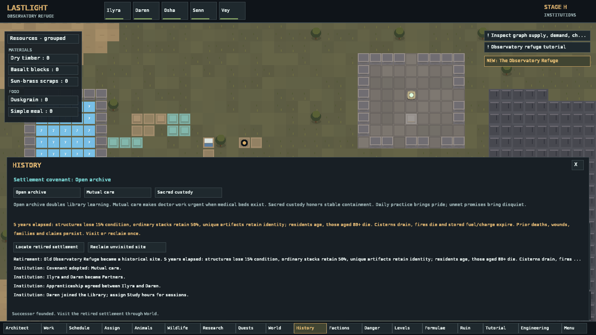

# Lastlight

  

**A single-player science-fantasy colony simulator about building a refuge beneath a failing sun.**

Command a small settlement in a deterministic world: assign work, construct rooms, manage farming and production, care for settlers and animals, navigate a dangerous region, make political agreements, and decide what survival means as the solar campaign advances. Built with **C# / .NET 8** and **MonoGame DesktopGL**.

> **Status: public release candidate (0.9.0-rc.1).** This is a playable vertical slice with a substantial campaign, **not a finished 1.0 game**. The supplied Windows build has not undergone hands-on testing on native Windows hardware; see [known limitations](docs/ROADMAP.md).



## Download and play

Download **`Lastlight-Windows-x64.zip`** from the project's GitHub Releases page (or use the separate Windows archive distributed with this repository). Extract the ZIP to a normal folder, then double-click **`Run-Lastlight.bat`** or **`Lastlight.exe`**. Keep the DLLs and `Assets/` folder together. **No .NET SDK or network connection is needed to play the packaged build.**

- **Platform:** Windows x64, OpenGL-capable GPU/driver, keyboard and mouse. Windows 10/11 are the intended targets, but native Windows compatibility still needs verification.
- **First start:** A new colony starts paused in Open Twilight. Press **Space** to begin; use **1**, **2**, or **3** for simulation speed.
- **Saves:** `%LOCALAPPDATA%\Lastlight\Saves` (Windows). Quicksave **F10**, quickload **F11**, with previous-save backup recovery.
- **Help:** **F12** in game; see [Getting started](docs/GETTING_STARTED.md), [Controls](docs/CONTROLS.md), and [Troubleshooting](docs/TROUBLESHOOTING.md).

## What you can do

- **Build and manage a colony:** architect plans, hauling, mining, stockpiles, crops, production bills, worker priorities, schedules, and policies.
- **Care for individuals:** named settlers with needs, injuries, medical treatment, relationships, equipment, memory, and work behavior.
- **Survive physical hazards:** multi-level terrain, structural support, water, heat, fire, electrical/mechanical/thaumic networks, livestock and finite resources.
- **Explore ruins and use magic:** an observatory mystery, crafting, research, learned formulae, components, and consequences.
- **Meet a living region:** factions, trade, expeditions, real cargo, contracts, diplomacy, settlement legacies, and cultural history.
- **Face the failing sun:** escalating light loss, forecasts, flares, scarcity, regional migration, disputed sanctuaries, customizable directors, and five different endgame projects.
- **Extend data safely:** opt-in additive JSON content packs for definitions, recipes and formulae. No executable mod scripts.
- **Save and continue:** deterministic simulation with versioned saves, integrity checks, and explicit migration paths for earlier formats.

| Regional exploration | Engineering and production |
| --- | --- |
|  |  |

| Solar campaign | Institutions and settlement legacy |
| --- | --- |
|  |  |

## Documentation

| For players | For developers and contributors |
| --- | --- |
| [Getting started](docs/GETTING_STARTED.md) | [Building from source](docs/BUILDING.md) |
| [Controls](docs/CONTROLS.md) | [Architecture](docs/ARCHITECTURE.md) |
| [Campaign and endings](docs/CAMPAIGN_GUIDE.md) | [Modding guide](docs/MODDING.md) |
| [Troubleshooting](docs/TROUBLESHOOTING.md) | [Testing](docs/TESTING.md) |
| [Features and limitations](docs/ROADMAP.md) | [Contributing](CONTRIBUTING.md) |
| [Full game asset inventory](docs/ASSETS.md) | [MIT license](LICENSE) |
| [Release notes](RELEASE_NOTES.md) | [Changelog](CHANGELOG.md) |

## Build it yourself

Install the [.NET 8 SDK](https://dotnet.microsoft.com/download/dotnet/8.0) and run from the repository root:

```sh
dotnet restore Lastlight.sln
dotnet build Lastlight.sln --configuration Release
dotnet run --project src/Lastlight.Desktop --configuration Release
```

The build downloads the MonoGame DesktopGL NuGet dependency. To run the packaged Windows version, use the GitHub Release asset rather than a source ZIP. See [build instructions](docs/BUILDING.md) for the Windows publish command and tests.

## Project structure

- `src/Lastlight.Core` — deterministic simulation, campaign and save system
- `src/Lastlight.Desktop` — MonoGame client, controls and **all eight runtime assets** under `Assets/`
- `src/Lastlight.Checks` — executable regression and acceptance checks
- `tests/fixtures` — **nine intentional compatibility/test checkpoints**, not player save files
- `docs` — guides, technical documentation and selected screenshots
- `licenses` — bundled third-party attributions and license texts
- `docs/ASSETS.md` — complete runtime asset inventory with file hashes and licensing
- `.github` — CI, release automation and issue templates

## Assets and licensing

This build does not provide the full proposed biome/content catalog, general-purpose executable modding, screen-reader support, or verified native Windows QA. The checks are automated, not a substitute for extended human playtesting; see [roadmap and known limitations](docs/ROADMAP.md).

**License:** Lastlight’s original source code, original game assets, and documentation are available under the [MIT License](LICENSE). The complete gameplay asset directory is **included in this repository**; nothing needs to be downloaded separately. The font atlas uses DejaVu glyphs, and external libraries retain their own licenses. See [game asset inventory](docs/ASSETS.md) and [third-party notices](licenses/THIRD-PARTY.md).
